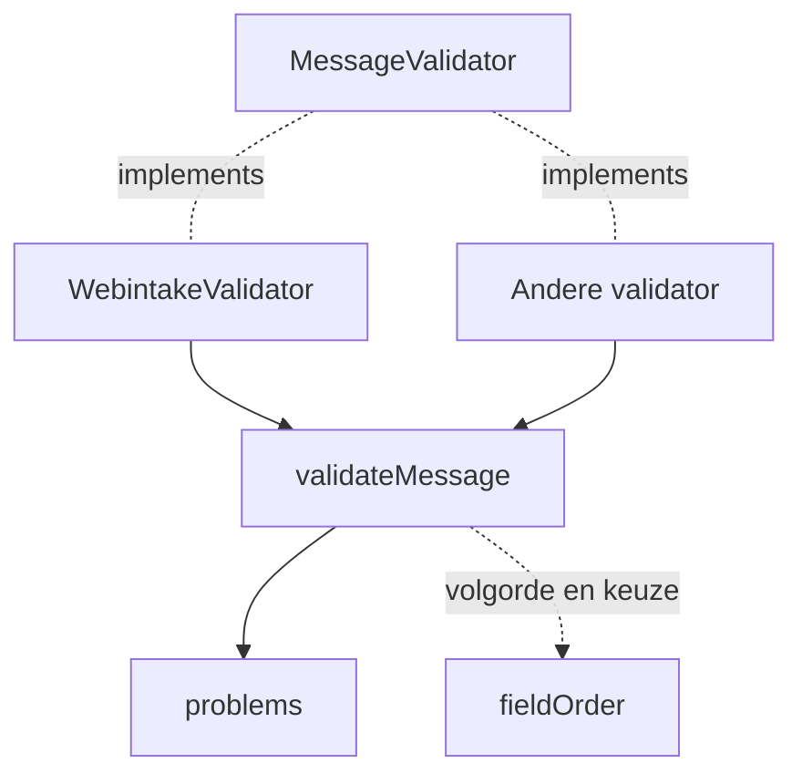

# Validatie

Controleert een bericht op vorm voordat het verstuurd wordt. Elk probleem wordt gelogd en teruggegeven, zodat de aanroepende code erop kan
handelen. De validator gooit nooit en verandert het bericht niet.

## Gebruik

```ts
import { MessageValidator, WebintakeValidator } from './validate/webintake/WebintakeValidator';

const validator: MessageValidator = new WebintakeValidator();
const result = validator.validate(message, { logger });
for (const problem of result.problems) {
  // { path: 'Toelichting', segments: ['Toelichting'], code: 'too_big', detail: 'Too big: ...', limit: { max: 1200 } }
}
```

De uitkomst is valid, invalid of error. Error betekent dat de validator zelf faalde en het bericht niet beoordeeld is. Je hoeft niets af te vangen.
Alleen logger is verplicht; logKeys en context staan uitgelegd in de JSDoc van ValidationOptions.

Path en detail van een probleem zijn voor mensen. Code, segments en limit zijn voor code die zelf wil handelen, bijvoorbeeld een te lange waarde
inkorten. Limit noemt de regel die geschonden is: min, max of de toegestane waarden.

- Alle problemen in één keer, ook de volgorde van velden als die voor het bericht telt.
- Per probleem een warn-regel met path, code, detail en limit, plus één samenvatting. Geen persoonsgegevens boven debug, de waarde alleen op debug.
- Logt via een child van de meegegeven Powertools Logger. Elke regel heeft component, de logsleutels van de validator en context. De logger van
  de aanroeper krijgt geen sleutels.

## Opbouw



Het contract staat in MessageValidator.ts: de interface MessageValidator met één methode, validate, plus de opties en het resultaat. Code die een
validator gebruikt, kent alleen dat bestand. De gedeelde logica (loggen, nooit gooien, problemen samenvoegen) staat in validateMessage.ts. Een
validator geeft die een definitie mee: naam, component, zod-schema en logsleutels, en checkOrder: true als de volgorde telt. De verwachte
volgorde komt dan uit het schema zelf. Een object waarin precies één veld hoort, krijgt in het schema .meta({ choice: true }). Een validator toevoegen: [nieuwe validator](docs/nieuwe-validator.md).

## Verder lezen

- [Technische keuzes](docs/technische-keuzes.md): waarom zod plus eigen code, met de vragen die je bij een eerste blik stelt.
- [Webintake](webintake/README.md): wat er in een Webintake-bericht gecontroleerd wordt.
