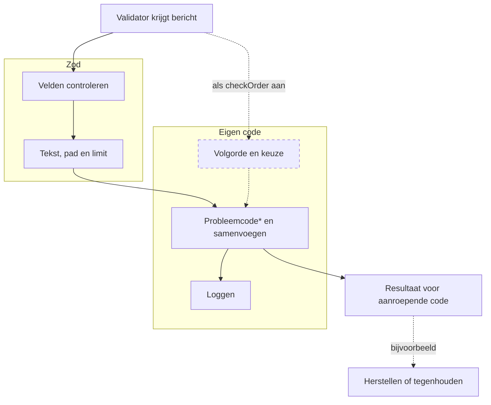

# Technische keuzes

## Zod en eigen code

Uitgangspunt: zod doet alles wat zod kan, en eigen code is er alleen waar zod tekortschiet. Elk stuk eigen code hieronder heeft een reden die
zod niet dekt. Komt er een nieuwe versie van zod die dat wel kan, dan gaat de eigen code eruit.

Bij Webintake telt de volgorde van de velden, en elke validator laat alle fouten in één keer zien. Zod controleert de velden, maar kan de
volgorde niet controleren zonder andere fouten kwijt te raken: vooraf mist zod dan de veldfouten van dat object, achteraf heeft zod de velden al
op schemavolgorde gezet. Daarom controleert fieldOrder de volgorde zelf, op het bericht zoals het binnenkomt. Met checkOrder aan draaien zod en
fieldOrder altijd allebei. De verwachte volgorde komt uit het zod-schema zelf: de volgorde waarin de velden geschreven zijn. Een validator
waarvoor de volgorde niet telt, zet checkOrder niet aan en gebruikt alleen zod.

Hetzelfde geldt voor een object waarin precies één van de velden hoort, zoals Berichtsoort bij Webintake. Een refine op dat object draait niet
als er in het object al een fout zit, en een union geeft bij een fout één samengevoegde melding. Zo'n object markeer je in het schema met
.meta({ choice: true }), en fieldOrder telt dan op de invoer welke velden er zijn. Dat gebeurt altijd, ook als checkOrder uit staat.



Gestippeld: alleen als de validator checkOrder aan heeft of een object met choice, en wat de aanroepende code met het resultaat kan doen.

\* Probleemcode: de code van zod, zoals too_big of unrecognized_keys, plus drie eigen codes. missing, omdat zod een ontbrekend veld invalid_type
noemt, net als een verkeerd type, en dat is voor beheer een ander probleem. order, omdat zod de volgorde niet controleert. choice, als een object
met choice geen of meer dan één veld heeft.

Alleen zod en de Powertools Logger, geen extra libraries.

Meldingen zijn de teksten van zod, met een eigen tekst waar zod onduidelijk is (ontbrekend veld, datum, volgorde). Zod zet geen invoerwaarden in
zijn teksten, dus er komen geen persoonsgegevens in de logs boven debug, zonder lijst met geheime velden. Op de probleemcode kunnen beheer in de
logs en de aanroepende code in het resultaat zoeken. Met segments en limit kan de aanroepende code een probleem zelf herstellen.

Nadelen: problems.ts leest de foutcodes van zod en fieldOrder leest de opbouw van het schema (shape, unwrap, element, meta). Die veranderen
waarschijnlijk alleen bij een nieuwe hoofdversie van zod. fieldOrder kijkt door .optional() en z.array heen; een object binnen bijvoorbeeld
.nullable() krijgt geen volgordecontrole.

## Vragen bij een eerste blik

### Waarom kan zod de volgorde niet controleren?

Een adres met dit schema, waarin Straatnaam vóór Huisnummer hoort:

```ts
const adres = z.strictObject({ Straatnaam: z.string().max(24), Huisnummer: z.string() });
```

En dit bericht, met twee fouten: Huisnummer staat vóór Straatnaam, en de straatnaam is 30 tekens.

```ts
{ Huisnummer: '10', Straatnaam: 'Verzonnenstraatnaamvan30tekens' }
```

Getest met zod 4.6.7:

| Waar de volgordecontrole zit | Wat er gemeld wordt |
|---|---|
| Nergens, alleen zod | Straatnaam te lang. De volgorde niet. |
| In zod achteraf, met refine of transform | Straatnaam te lang. De volgorde niet: zod zet Straatnaam al vooraan, dus de fout is weg. |
| In zod vooraf, met preprocess | De volgorde. Straatnaam te lang niet: na een fout in preprocess controleert zod de velden niet meer. |
| Naast zod, met fieldOrder | Allebei. |

Daarom draait fieldOrder naast zod, op de ruwe invoer.

### Moet ik de volgorde ergens apart vastleggen?

Nee. De verwachte volgorde is de volgorde waarin de velden in het zod-schema staan. Zet checkOrder aan in de definitie en schrijf de velden in
de juiste volgorde.

### Waarom niet alleen de probleemcodes van zod?

We gebruiken ze wel, op drie na. Zod noemt een ontbrekend veld invalid_type, net als een verkeerd type. Voor beheer en voor herstel zijn dat
twee verschillende problemen, dus een ontbrekend veld heet missing. Zod kent geen volgorde, dus een volgordefout heet order. En "precies één van"
controleert fieldOrder, dus die fout heet choice.

### Waarom gooit de validator nooit een exception?

Zodat validatie de aanroepende code nooit kan laten falen, ook niet in productie naast een bestaande flow. Een fout in de validator zelf geeft
status error; dat zegt niets over het bericht.

Ook een ongeldig bericht geeft geen exception maar een resultaat met de problemen. Dan kan de aanroepende code zelf beslissen wat er gebeurt.
Een straatnaam van 30 tekens, waar 24 mag, hoeft het bericht niet tegen te houden: met code too_big, segments en limit kan eigen code de
straatnaam inkorten, dat loggen en opnieuw valideren.

### Waarom staat de waarde van een veld alleen op debug?

Berichten kunnen persoonsgegevens bevatten. Path, code en detail bevatten geen waarden en mogen op warn. De waarde komt in een aparte
debug-regel, zodat die alleen zichtbaar is als het logniveau op DEBUG staat. Acceptance draait op DEBUG en krijgt alleen testgegevens; daar zie je
de waarden dus wel, wat helpt bij het uitzoeken van een probleem.
