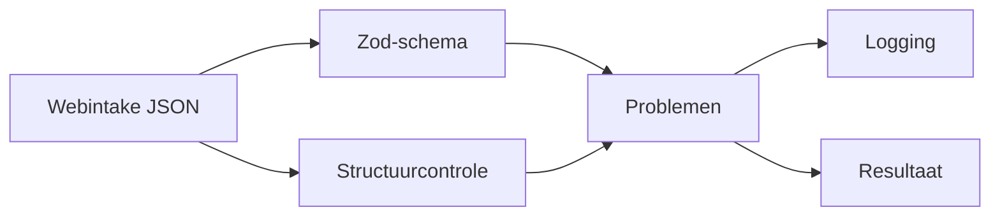
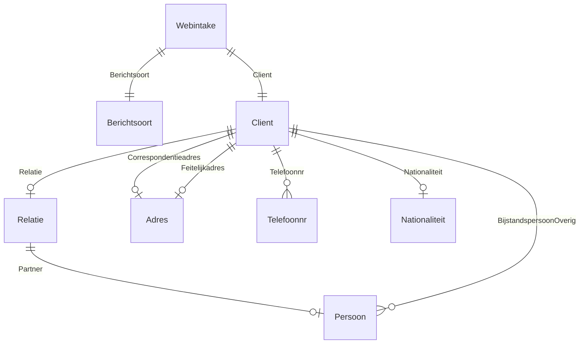
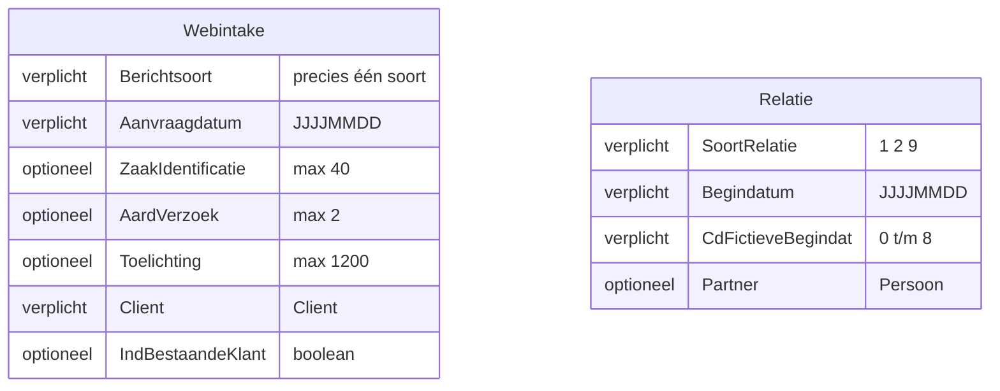
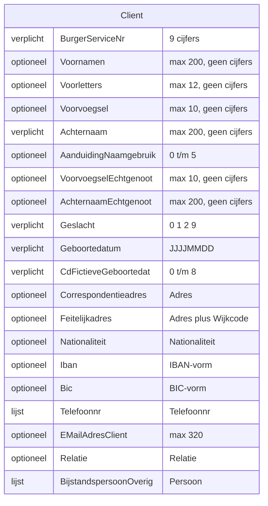
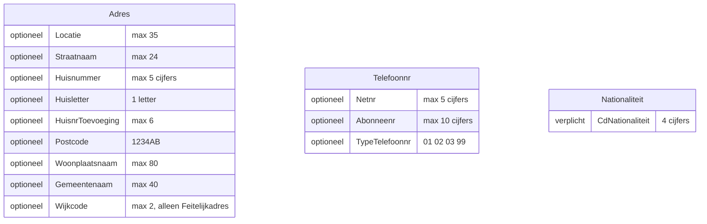

# Webintake-validatie

Controleert een Webintake-bericht (JSON) op vorm: velden, verplichte en onbekende velden, volgorde en Berichtsoort. Het bericht wordt één op één naar
XML omgezet, dus de volgorde van de sleutels telt.

validateWebintake gooit nooit en verandert het bericht niet. Uitkomst: valid, invalid of error. Error betekent dat de validator zelf faalde en het
bericht niet beoordeeld is.

## Opbouw

Het zod-schema controleert per veld type, verplicht, lengte, patroon en toegestane waarden, en meldt onbekende velden. De structuurcontrole loopt
over de ruwe invoer en controleert de volgorde per object en dat er precies één Berichtsoort is. Dat kan niet in zod: een refine op een object draait
niet als een veld al fout is, en zod geeft de sleutels al gesorteerd door. Beide controles draaien altijd, zodat één bericht alle problemen tegelijk
oplevert.

Per object staat de veldvolgorde op één plek (orderedObject). Het zod-schema en de structuurcontrole komen allebei uit die lijst.

Mappen en bestanden: zie [opbouw.md](opbouw.md).

## Berichtstructuur

Precies één (||), optioneel (o|) of een lijst (o{). Persoon zijn de velden van Client zonder Relatie en BijstandspersoonOverig. Feitelijkadres heeft
achteraan nog Wijkcode.

In de diagrammen hieronder is de volgorde van de velden de volgorde in het bericht. Links staat of een veld verplicht, optioneel of een lijst is.

Berichtsoort heeft precies één van deze soorten, elk met Onderwerp en waar genoemd een optionele Categorie:

| Soort | Onderwerp | Categorie |
|---|---|---|
| WWB | 01 | 01 |
| IOAW | 02 | 02, 03 |
| WMO | 03 | 04 t/m 11 |
| REI, SHV, INB | 04, 05, 06 | geen |
| VRIJ | 50 t/m 99 | 50 t/m 99 |

## Meldingen en logging

Elk probleem heeft een pad (Client.Relatie.Partner.Geboortedatum), een code en een detail. Codes: missing, unknown_field, order, type, format, length,
not_allowed, choice.

| Niveau | Wanneer | Inhoud |
|---|---|---|
| info | Geldig | Berichtsoort |
| warn | Per probleem en één samenvatting | Pad, code, detail; geen persoonsgegevens |
| debug | Per probleem | Pad en de werkelijke waarde |
| error | Validator faalt | Foutmelding, geen berichtinhoud |

De validator logt via een child van de meegegeven Powertools Logger. De logger van de aanroeper krijgt geen extra sleutels.

Elke regel bevat component en zaakIdentificatie, plus de context die de aanroeper meegeeft. Zo zijn alle regels van één bericht te groeperen.
ZaakIdentificatie komt van de aanroeper, anders uit het bericht, anders unknown. Een waarde staat alleen buiten debug als het veld niet geheim is:
codes, ZaakIdentificatie en Aanvraagdatum.
Onbekende velden komen per object samen in één melding.
