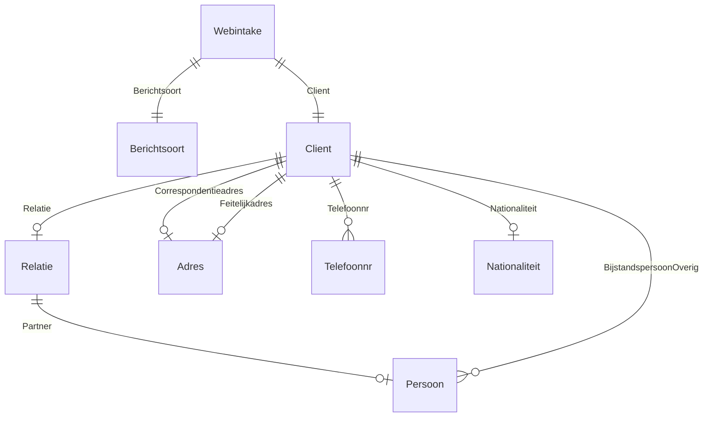
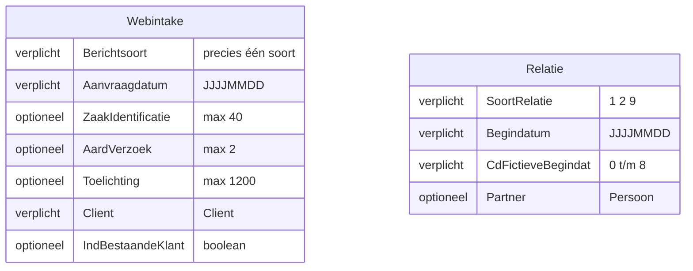
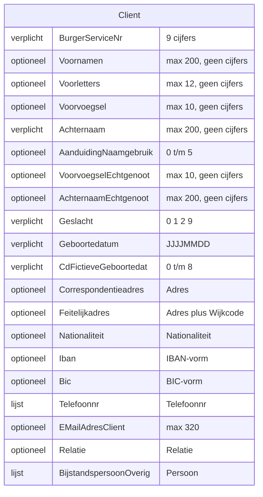
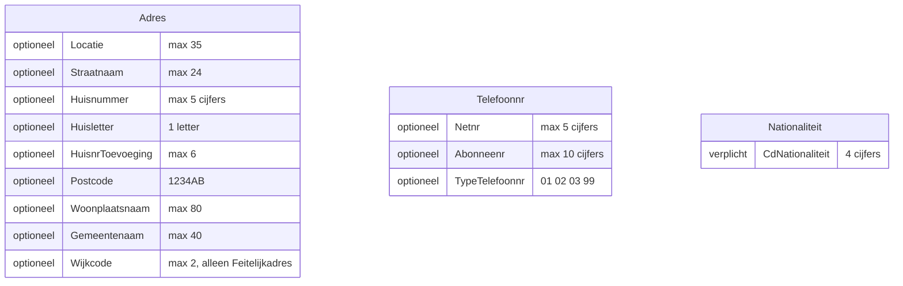

# Webintake-validatie

WebintakeValidator controleert een Webintake-bericht (JSON) op vorm: velden, verplichte en onbekende velden, volgorde en Berichtsoort. Het bericht
wordt één op één omgezet, dus de volgorde van de sleutels telt. Gebruik en gedrag: [validatie](../README.md). Waarom zod plus een eigen
volgordecontrole: [technische keuzes](../docs/technische-keuzes.md). Mappen en bestanden: [opbouw](docs/opbouw.md).

## Berichtstructuur

Precies één (||), optioneel (o|) of een lijst (o{). Persoon zijn de velden van Client zonder Relatie en BijstandspersoonOverig. Feitelijkadres heeft
achteraan nog Wijkcode.

In de diagrammen hieronder is de volgorde van de velden de volgorde in het bericht. Links staat of een veld verplicht, optioneel of een lijst is.

SoortRelatie: 1 huwelijk, 2 geregistreerd partnerschap, 9 anders. CdFictieveGeboortedat en CdFictieveBegindat zeggen welk deel van de datum
ervoor fictief is: 0 geen, 1 dag, 2 maand, 3 dag en maand, 4 jaar, 5 dag en jaar, 6 maand en jaar, 7 dag, maand en jaar, 8 onbekend welke delen.

Berichtsoort heeft precies één van deze soorten, elk met Onderwerp en waar genoemd een optionele Categorie:

| Soort | Onderwerp | Categorie |
|---|---|---|
| WWB | 01 | 01 |
| IOAW | 02 | 02, 03 |
| WMO | 03 | 04 t/m 11 |
| REI, SHV, INB | 04, 05, 06 | geen |
| VRIJ | 50 t/m 99 | 50 t/m 99 |

## Meldingen en logging

Het pad begint bij Webintake, bijvoorbeeld Client.Relatie.Partner.Geboortedatum. Een probleem op Webintake zelf, zoals een onbekend veld bovenaan,
heeft als pad Webintake. Codes: die van zod (zoals too_big, invalid_value, unrecognized_keys), plus missing, order en choice (Berichtsoort heeft
niet precies één soort).

| Niveau | Wanneer | Inhoud |
|---|---|---|
| info | Geldig | Webintake valid, met de vaste sleutels |
| warn | Per probleem en één samenvatting | Pad, code, detail en limit, geen persoonsgegevens |
| debug | Per probleem | Pad en de werkelijke waarde |
| error | Validator faalt | Foutmelding, geen berichtinhoud |

Elke regel heeft component webintake-validation en zaakIdentificatie, zodat alle regels van één bericht te groeperen zijn. ZaakIdentificatie komt
uit het bericht, anders unknown. De aanroeper kan hem overschrijven met logKeys.
