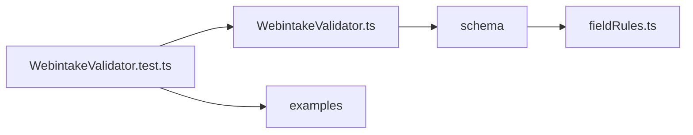

# Opbouw

```
webintake/
  README.md                     wat er gevalideerd wordt
  docs/
    opbouw.md                   deze pagina
  WebintakeValidator.ts         klasse die MessageValidator implementeert, zaakIdentificatie voor de logregels
  schema/
    webintake.ts                Webintake en Berichtsoort
    persoon.ts                  persoon en client: naam, BSN, geboortedatum, e-mail, telefoon, nationaliteit, Relatie
    adres.ts                    Correspondentieadres en Feitelijkadres
    fieldRules.ts               regels per veld: datum, aardVerzoek, bsn, postcode, ...
  test/
    WebintakeValidator.test.ts  alle testscenario's
    examples/                   voorbeeldberichten met nepgegevens
      valid.json                geldig en volledig
      errors.json               fouten bovenaan in Webintake
      berichtsoort.json         fouten in Berichtsoort
      client.json               fouten in Client
      adres-telefoon.json       fouten in adres en Telefoonnr
      production.json           vorm van de huidige mapper
```



WebintakeValidator gebruikt de algemene delen in src/validate, zie [validatie](../../README.md). Alles wat Webintake kent, staat in deze map.

De indeling volgt het bericht: een bestand per deel van de structuur, zodat je een veld vindt via het object waar het in zit. Persoon bevat alles
wat bij een persoon hoort, ook e-mail, telefoon en nationaliteit. Adres staat apart omdat het twee keer voorkomt. Alle bestanden in schema
gebruiken fieldRules.ts en gewone zod.

Alle tests staan in WebintakeValidator.test.ts en lopen via WebintakeValidator, met de voorbeeldberichten uit examples. Er zijn geen tests per
bronbestand. Elk deel van het bericht heeft een eigen voorbeeld met fouten, zodat de verwachte problemen per test kort blijven.
