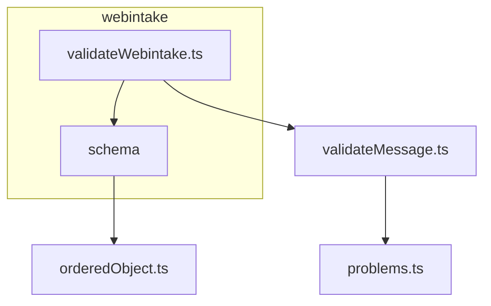

# Opbouw

```
src/validate/
  validateMessage.ts              valideren en loggen voor elk bericht, gooit nooit
  orderedObject.ts                veldenlijst naar zod-schema, volgorde- en keuzecontrole
  problems.ts                     Problem, codes en detail zonder persoonsgegevens
  webintake/
    README.md                     wat er gevalideerd wordt
    opbouw.md                     deze pagina
    validateWebintake.ts          ingang: Webintake-schema en welke velden niet geheim zijn
    schema/
      webintake.ts                Webintake en Berichtsoort
      persoon.ts                  persoon en client: naam, BSN, geboortedatum, e-mail, telefoon, nationaliteit, Relatie
      adres.ts                    Correspondentieadres en Feitelijkadres
      fieldRules.ts               regels per soort veld: datum, bsn, e-mail, postcode, ...
    test/
      validateWebintake.test.ts   alle testscenario's
      examples/                   voorbeeldberichten met nepgegevens
        valid.json                geldig en volledig
        errors.json               fouten op alle niveaus tegelijk
        production.json           vorm van de huidige mapper
```



Alle bestanden in schema gebruiken fieldRules.ts en orderedObject.ts. validateMessage.ts, orderedObject.ts en problems.ts staan in src/validate
omdat ze geen veldnamen kennen en voor elk bericht bruikbaar zijn. Alles wat Webintake kent, staat in webintake.

De indeling volgt het bericht: een bestand per deel van de structuur, zodat je een veld vindt via het object waar het in zit. Persoon bevat alles
wat bij een persoon hoort, ook e-mail, telefoon en nationaliteit. Adres staat apart omdat het twee keer voorkomt.

Alle tests staan in validateWebintake.test.ts en lopen via validateWebintake, met de voorbeeldberichten uit examples. Er zijn geen tests per
bronbestand.
